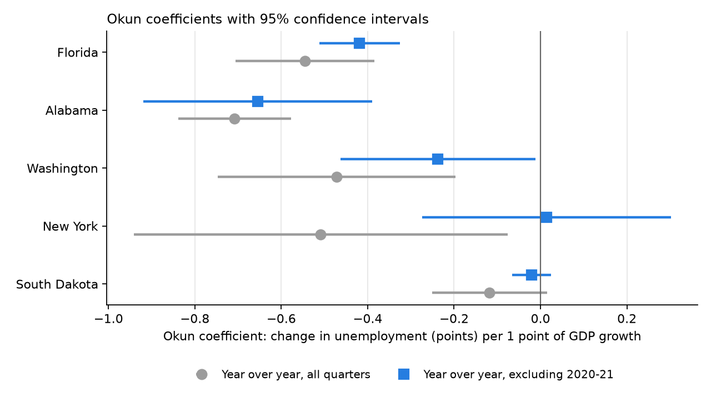

# Okun's Law Across U.S. States

Does faster GDP growth lower unemployment by the same amount in every state? This project tests Okun's Law for Florida, Alabama, Washington, New York and South Dakota using quarterly data from 2005 to 2022.

It's a rebuild of my 2024 undergraduate econometrics paper. The original regressed the unemployment *level* on GDP growth and found almost nothing. This version uses the specification Okun's Law actually describes and shows why the first one failed.



## Key findings

- **The 2024 null result came from the model, not the economy.** Regressing the unemployment level on GDP growth gives R² ≤ 0.05 and Durbin-Watson statistics of 0.17–0.53, a sign of misspecification. Modeling the *change* in unemployment fixes both problems.
- **Outside the pandemic, Okun's Law holds clearly in Florida and Alabama.** Excluding 2020–21, one extra point of year-over-year GDP growth goes with unemployment about 0.42 points lower in Florida (R² ≈ 0.68) and 0.65 points lower in Alabama. Both stay significant in the quarterly model. Washington is borderline.
- **New York and South Dakota show no stable relationship outside 2020–21.** Their full-sample coefficients are driven by the pandemic shock.
- **States don't share one coefficient.** A Wald test rejects equal slopes across the five states (χ²(4) = 75.6, p < 0.001).

## Methods

- **Replication** of the 2024 level model, to show the problem.
- **Augmented Dickey-Fuller tests** for unit roots.
- **Okun's difference form**, ΔU = α + β·g, estimated separately for each state:
  - quarter-on-quarter and year-over-year versions
  - with and without the 2020–21 COVID quarters
- **Newey-West (HAC) standard errors** (4 lags), so inference is valid with autocorrelated errors.
- **A pooled regression with state-specific slopes**, plus a Wald test that all five slopes are equal.

## Read the results

- **[Report (HTML)](report/okun_report.html):** the full analysis with charts, no code.
- **[Notebook](okun_analysis.ipynb):** the same analysis with code and outputs.

## Project structure

```
data/original_2024_data.csv   quarterly unemployment rate and real GDP, 5 states, 2005–2022
src/okun.py                   helper functions: variables, regressions, tests
src/fetch_fred.py             optional: download fresh data from FRED
okun_analysis.ipynb           the analysis, start to finish
figures/                      charts used in the report
report/okun_report.html       the report without code
```

## Run it

```bash
python -m venv venv
source venv/bin/activate          # Windows: venv\Scripts\activate
pip install -r requirements.txt
jupyter notebook okun_analysis.ipynb
```

To refresh the data, run `python src/fetch_fred.py`, then point `DATA_PATH` in the notebook to `data/fred_data.csv`.

## Data

The data come from FRED (Federal Reserve Bank of St. Louis): state unemployment rates (BLS) and state real GDP (BEA), quarterly. The included file is my 2024 download. In that file, Alabama's unemployment series is not seasonally adjusted while the others are; `fetch_fred.py` downloads seasonally adjusted series for all five states.

## Limitations

- A bivariate model for five states. Explaining *why* states differ (industry mix, unionization, labor-market flexibility) would need more variables and more states.
- Year-over-year changes overlap and are persistent. The quarterly model is used as a check.
- Excluding 2020–21 is a judgment call, so results are reported both ways.
- These are associations, not causal effects.

## Author

Sebastián Pedraza, MS Applied Data Science, New College of Florida. Original paper: *State-Level Estimation of Okun's Law* (Econometrics, December 2024). 
